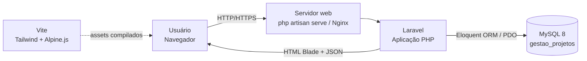
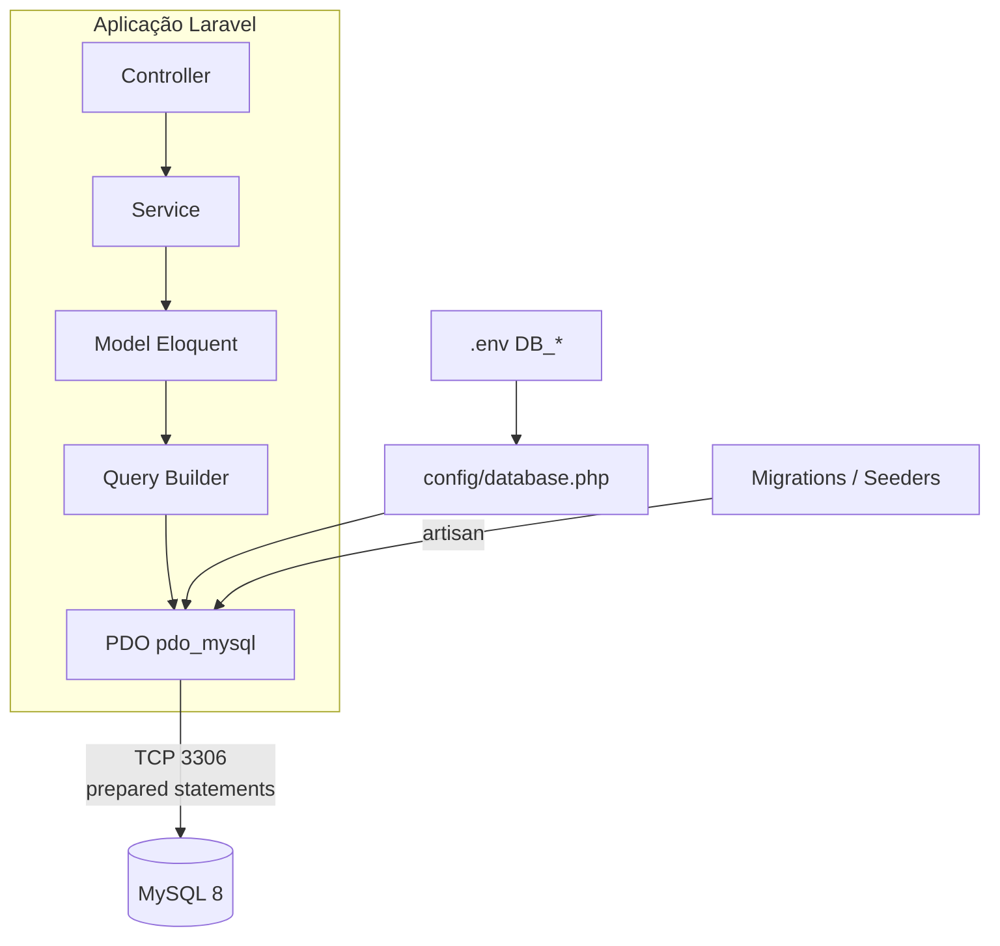
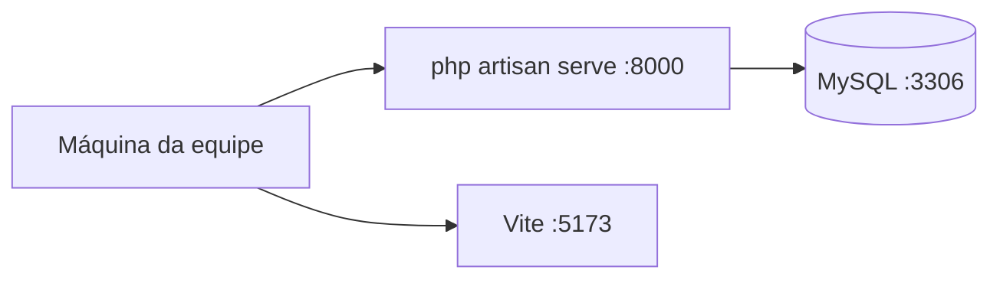

# Arquitetura do Sistema

Documento central do projeto. Descreve como o sistema é organizado e, principalmente, como as camadas se comunicam, do navegador ao banco de dados. Este é o ponto de maior peso na avaliação e deve guiar a apresentação.

## 1. Visão geral

A aplicação segue a arquitetura **MVC em camadas sobre o Laravel**, em modelo **monolítico renderizado no servidor** (server-side rendering com Blade), com **banco relacional MySQL** acessado exclusivamente pelo ORM Eloquent. Há um único processo de aplicação, o que simplifica a implantação local e a demonstração.



## 2. Camadas e responsabilidades

| Camada | Local | Responsabilidade |
|---|---|---|
| Apresentação | `resources/views`, Tailwind, Alpine.js | Renderizar HTML, componentes reutilizáveis, interação no cliente (arrastar e soltar, modais) |
| Roteamento | `routes/web.php` | Mapear URL e verbo HTTP para um controller; aplicar middleware |
| Middleware | `auth`, `verified`, `ValidateCsrfToken` | Autenticação, sessão, proteção CSRF |
| Controle | `app/Http/Controllers` | Receber a requisição, delegar e escolher a resposta. Sem regra de negócio |
| Validação | `app/Http/Requests` | Validar e normalizar a entrada antes de chegar ao controller; o `authorize()` de cada FormRequest consulta a Policy |
| Autorização | `app/Policies` | Decidir se o usuário pode ver ou alterar um recurso (`ProjectPolicy`, `TaskPolicy`) |
| Serviço | `app/Services` | Regras de negócio, transações e registro de atividades (`ProjectService`, `TaskService`, `DashboardService`, `ActivityLogger`) |
| Composição de views | `app/View/Composers` | Entregar dados comuns ao layout (projetos da barra lateral) sem consulta no Blade |
| Domínio e persistência | `app/Models` (Eloquent), `app/Enums` | Entidades, relacionamentos, escopos, casts e enums de domínio (`TaskStatus`, `TaskPriority`, `ProjectRole`) |
| Acesso a dados | Eloquent, Query Builder, PDO | Gerar SQL parametrizado e executar no MySQL |
| Banco de dados | MySQL 8 | Armazenamento, integridade referencial, índices e transações |

## 3. Ciclo de uma requisição

Exemplo: o usuário move um cartão de "A fazer" para "Em andamento" no Kanban.

```mermaid
sequenceDiagram
    participant N as Navegador (Alpine.js)
    participant R as Roteador + Middleware
    participant C as TaskController
    participant Q as UpdateTaskStatusRequest
    participant P as TaskPolicy
    participant S as TaskService
    participant M as Model Task (Eloquent)
    participant B as MySQL

    N->>R: PATCH /tasks/15/status {status: "doing", position: 1}<br/>(cookie de sessão + X-CSRF-TOKEN)
    R->>R: Valida sessão (auth) e token CSRF
    R->>M: Route model binding: SELECT * FROM tasks WHERE id = ?
    R->>Q: Resolve UpdateTaskStatusRequest
    Q->>P: authorize(): can('update', task)
    P->>B: SELECT ... FROM users JOIN project_user ... (é membro?)
    Q->>Q: rules(): status ∈ {todo, doing, review, done}, position ≥ 0
    Q->>C: updateStatus(request, task)
    C->>S: moveTo(task, user, TaskStatus::Doing, 1)
    S->>B: BEGIN
    S->>B: SELECT id FROM tasks WHERE project_id=? AND status=? ... FOR UPDATE
    S->>M: task->status = doing; position = 1; save()
    M->>B: UPDATE tasks SET status=?, position=? WHERE id=? (prepared statement)
    S->>B: UPDATE tasks SET position=? WHERE id=? (renumera as duas colunas)
    S->>M: ActivityLogger->log('task.moved', {from, to})
    M->>B: INSERT INTO activity_logs ...
    S->>B: COMMIT
    S-->>C: tarefa atualizada
    C-->>N: JSON 200 {message, task} (o quadro mostra um aviso, sem recarregar)
```

Passos em prosa: o navegador (componente Alpine `kanban`, ao soltar o cartão) envia a requisição com cookie de sessão e token CSRF; o middleware autentica e valida o CSRF; o roteador carrega a tarefa pelo id (route model binding); o `FormRequest` primeiro chama a `Policy` (quem não é membro recebe **403** antes de qualquer validação) e depois valida o corpo (status inválido gera **422** com mensagem em português); o controller delega ao `TaskService`, que abre uma transação, bloqueia a coluna de destino (`FOR UPDATE`, evitando posições duplicadas em acessos simultâneos), altera a tarefa, renumera as colunas e grava o log de atividade; o Eloquent traduz tudo em SQL com parâmetros vinculados via PDO; o MySQL confirma a transação; o controller responde em JSON. Se a resposta não for 2xx, o JavaScript devolve o cartão à coluna original, de modo que a tela sempre reflete o banco.

O mesmo endpoint atende ao seletor de status da página da tarefa: sem `Accept: application/json`, o controller responde com redirect e mensagem de sucesso.

## 4. Comunicação entre banco de dados e back-end

Esta seção responde diretamente à pergunta "como o banco de dados se comunica com o back-end".

1. **Configuração.** O arquivo `.env` define `DB_CONNECTION=mysql`, host, porta, nome do banco, usuário e senha. `config/database.php` lê essas variáveis e monta a conexão.
2. **Driver.** O Laravel usa a extensão **PDO (pdo_mysql)** do PHP para abrir a conexão TCP com o MySQL na porta 3306. A conexão é criada de forma preguiçosa, na primeira consulta da requisição, e encerrada ao final.
3. **Abstração.** O código da aplicação nunca escreve SQL manualmente. Os **Models Eloquent** (`Project`, `Task`, `User`, `Comment`, `ActivityLog`) representam tabelas, e métodos como `Task::where(...)->with('assignee')->get()` são convertidos pelo Query Builder em SQL.
4. **Segurança.** Todas as consultas usam **prepared statements** com parâmetros vinculados, o que elimina SQL Injection. Atribuição em massa é limitada por `$fillable`.
5. **Relacionamentos.** `Project hasMany Task`, `Task belongsTo User` (responsável), `Project belongsToMany User` (tabela pivô `project_user` com `role`). Carregamento antecipado com `with()` evita o problema N+1.
6. **Integridade.** O banco impõe chaves estrangeiras, unicidade e `NOT NULL`; a aplicação valida antes (FormRequest), e o banco é a última barreira.
7. **Transações.** Operações compostas (mover tarefa e registrar atividade; criar projeto e vincular proprietário) executam em `DB::transaction`, garantindo atomicidade.
8. **Esquema versionado.** Migrations em `database/migrations` criam e evoluem o esquema; seeders e factories geram dados de demonstração. `php artisan migrate:fresh --seed` reconstrói o banco do zero.
9. **Sessões e cache.** Sessão e cache usam o próprio MySQL (`SESSION_DRIVER=database`, `CACHE_STORE=database`), evitando um serviço adicional.
10. **Consultas agregadas.** Os indicadores do painel são calculados pelo próprio MySQL (`COUNT`, `SUM(CASE ...)`, `GROUP BY`, `JOIN`) via Query Builder no `DashboardService`, em vez de carregar tarefas para contar em PHP. Ver `docs/BANCO_DE_DADOS.md`.
11. **Sem N+1.** As listagens usam `with()` e `withCount()`; o `AppServiceProvider` liga `Model::shouldBeStrict()`, então os testes falham se alguma página fizer lazy loading. No ambiente local o mesmo caso vira apenas um aviso no log, para não interromper a demonstração.
12. **Enums compartilhados.** `TaskStatus`, `TaskPriority` e `ProjectRole` (em `app/Enums`) definem os valores das colunas `ENUM` nas migrations, os casts dos models e as regras de validação, mantendo banco e código sincronizados.



## 5. Autenticação e autorização

- **Autenticação:** Laravel Breeze (formulários Blade). Senhas com hash bcrypt (`Hash::make`); sessão em cookie `HttpOnly` com ID armazenado em `sessions`.
- **Autorização:** `ProjectPolicy` e `TaskPolicy`. Regra base: só membros do projeto veem o projeto e suas tarefas; só o proprietário edita, arquiva, exclui ou gerencia membros; membros criam, editam e movem tarefas e comentam; excluir tarefa cabe ao proprietário do projeto ou a quem a criou; projeto arquivado fica somente leitura. As negativas trazem mensagem em português, exibida na página de erro 403.
- **Escopo das rotas aninhadas:** `projects/{project}/tasks/{task}` usa `scoped()`, então uma tarefa de outro projeto responde 404 mesmo que o id exista.
- **CSRF:** token em todos os formulários e no cabeçalho `X-CSRF-TOKEN` das requisições do Alpine.js.
- **Atribuição em massa:** `owner_id`, `project_id` e `created_by` não são preenchíveis; os Services os definem a partir do usuário autenticado.

## 6. Módulos funcionais

| Módulo | Rotas principais | Observação |
|---|---|---|
| Autenticação | `/register`, `/login`, `/logout`, `/profile` | Breeze, telas traduzidas |
| Painel | `GET /dashboard` | `DashboardController` → `DashboardService` (agregações SQL) |
| Projetos | `resource /projects`, `PATCH /projects/{p}/archive`, `PATCH /projects/{p}/restore` | `ProjectController` → `ProjectService`. `show` é o quadro Kanban |
| Membros | `GET/POST /projects/{p}/members`, `DELETE /projects/{p}/members/{u}` | `MemberController` → `ProjectService`. Adição por e-mail de usuário já cadastrado |
| Tarefas | `resource /projects/{p}/tasks` (exceto index), `PATCH /tasks/{t}/status` | `TaskController` → `TaskService`. Filtros por `?assignee=&priority=&q=` |
| Comentários | `POST /tasks/{t}/comments` | `CommentController` → `TaskService::comment` |
| Atividades | `GET /projects/{p}/activity` | `ActivityController` → `ProjectService::activityOf` (paginado) |

Todas as rotas acima, exceto as de visitante do Breeze, estão no grupo `auth` + `verified` em `routes/web.php`. `php artisan route:list --except-vendor` mostra a lista completa.

## 7. Front-end

Páginas renderizadas por Blade com dois layouts (`layouts/app.blade.php`, com barra lateral, e `layouts/guest.blade.php`, para login e cadastro) e componentes reutilizáveis em `resources/views/components`: `x-button`, `x-card`, `x-badge`, `x-modal`, `x-dropdown`, `x-field`, `x-text-input`, `x-select`, `x-textarea`, `x-avatar`, `x-avatar-stack`, `x-empty-state`, `x-page-header`, `x-project-header`, `x-due-date`, `x-activity-item`, `x-flash`, `x-pagination` e `x-icon` (um único conjunto de ícones, Heroicons, embutido em SVG).

- **Tailwind CSS** define a identidade visual por tokens em `tailwind.config.js`: `brand` (índigo, cor primária), `accent` (âmbar, destaque) e cores semânticas (`canvas`, `surface`, `line`, `ink`) ligadas a variáveis CSS em `resources/css/app.css`. O tema escuro troca apenas essas variáveis (classe `dark` no `<html>`).
- **Alpine.js** (`resources/js/app.js`) registra três componentes: `themeToggle` (tema claro/escuro salvo no navegador, aplicado antes da renderização para não "piscar"), `toaster` (avisos de sucesso e erro) e `kanban` (liga o SortableJS às colunas, envia o `fetch` com CSRF e desfaz o movimento se o servidor recusar). Modais e menus usam Alpine diretamente.
- **SortableJS** roda em modo `forceFallback` (eventos de mouse/toque em vez do arrastar nativo do HTML5), o que dá o mesmo comportamento em todos os navegadores e no celular.
- **Vite** compila e serve os assets (hot reload em desenvolvimento; `npm run build` gera `public/build`).
- Mensagens de validação e de autenticação em português ficam em `lang/pt_BR`. Páginas de erro próprias (403, 404, 419, 500) em `resources/views/errors`.

## 8. Estrutura de diretórios

```
app/
  Enums/                TaskStatus, TaskPriority, ProjectRole
  Http/Controllers/     Dashboard, Project, Member, Task, Comment, Activity (+ Auth e Profile do Breeze)
  Http/Requests/        StoreProject, UpdateProject, StoreMember, StoreTask, UpdateTask, UpdateTaskStatus, StoreComment
  Models/               User, Project, Task, Comment, ActivityLog
  Policies/             ProjectPolicy, TaskPolicy
  Services/             ProjectService, TaskService, DashboardService, ActivityLogger
  View/Composers/       SidebarComposer
database/migrations     Esquema versionado (2026_11_09_00000X_*)
database/factories      Fábricas para testes
database/seeders        DatabaseSeeder → DemoSeeder (dados de demonstração)
lang/pt_BR              Mensagens de validação e autenticação
resources/views         layouts, components, dashboard, projects, tasks, errors, auth, profile
resources/js/app.js     Componentes Alpine (tema, avisos, Kanban)
routes/web.php          Rotas protegidas por auth
tests/Feature, Unit     Testes (Pest)
```

Fluxo de dependência permitido: `Controller -> Service -> Model`. Camadas inferiores nunca chamam superiores; Blade só lê dados já preparados (o layout recebe a lista de projetos pelo `SidebarComposer`, que usa o `ProjectService`).

## 9. Implantação e execução

Local: `php artisan serve` + `npm run dev` + MySQL local. Remota (opcional): PHP-FPM + Nginx, `npm run build`, `php artisan migrate --force`, `php artisan config:cache route:cache`. O enunciado aceita execução local ou remota.



## 10. Decisões e trade-offs

| Decisão | Alternativa | Motivo |
|---|---|---|
| Monólito com Blade | SPA React/Vue + API | Menos partes móveis, entrega no prazo, boa estética com Tailwind |
| Eloquent ORM | SQL manual | Segurança, produtividade, relacionamentos expressivos |
| MySQL | SQLite/PostgreSQL | Alinhado à disciplina de banco de dados; relacional e robusto |
| Services | Lógica no controller | Testabilidade e controllers finos |
| Sessão no banco | Redis | Dispensa serviço extra |

Detalhes em `docs/adr/0001-stack.md`.

## 11. Testes

`php artisan test` roda a suíte Pest (SQLite em memória, banco recriado a cada teste). Cobertura dos critérios de aceite de `docs/REQUISITOS.md`:

| Arquivo | O que garante |
|---|---|
| `ProjectAccessTest` | Visitante vai para o login; não membro recebe 403 em quadro, membros, atividades, tarefa, mover e comentar; tarefa de outro projeto dá 404 |
| `ProjectTest` | Criação vincula proprietário e registra atividade; só o dono edita, arquiva e exclui; exclusão em cascata |
| `MemberTest` | Adição por e-mail, mensagens de erro em português, remoção libera tarefas e corta o acesso |
| `TaskTest` | Título obrigatório (RF04), responsável precisa ser membro, edição, regra de exclusão, filtros (RF09) |
| `KanbanTest` | Mover persiste status e posição e renumera colunas (RF05); status inválido 422; projeto arquivado 403 |
| `CommentTest` | Comentário publicado aparece no histórico (RF07, RF08) |
| `DashboardTest` | Indicadores iguais à contagem real no banco, ignorando projetos arquivados e alheios (RF06) |
| `DemoSeederTest` | `migrate:fresh --seed` deixa a demonstração pronta, com o 403 demonstrável (RNF05) |

Os testes do Breeze (login, cadastro, senha, perfil) continuam na suíte.

## 12. Limitações conhecidas e evolução

Sem notificações em tempo real (WebSockets), sem envio de e-mail de convite e sem API pública. Evoluções possíveis: Laravel Reverb para tempo real, filas para e-mails, API REST com Sanctum, anexos em tarefas.
