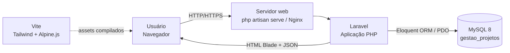
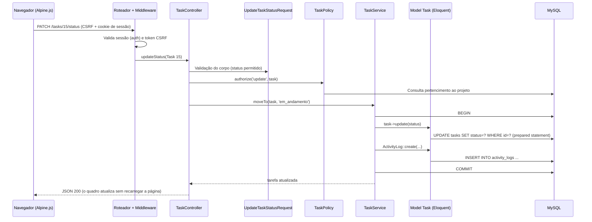
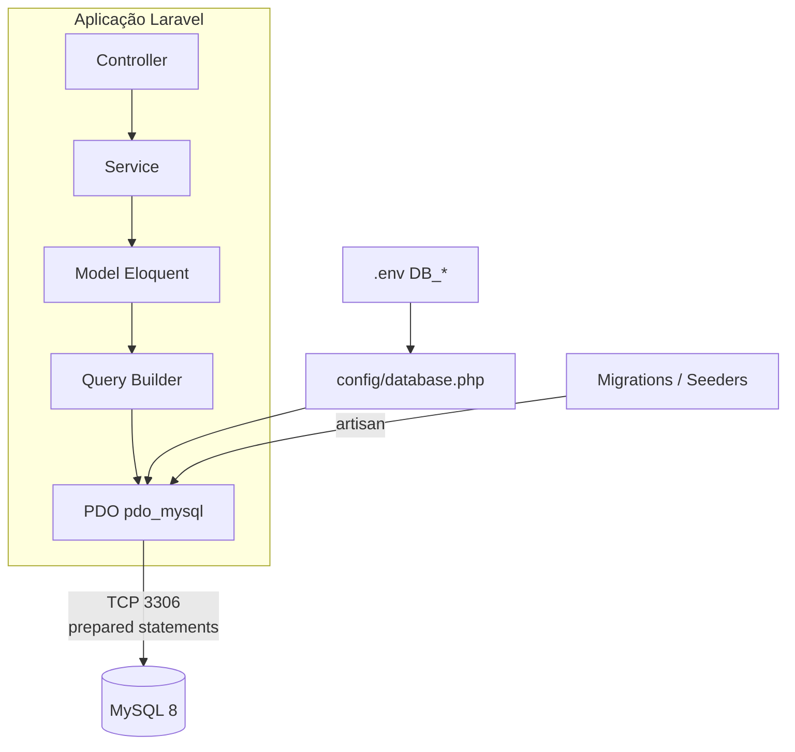
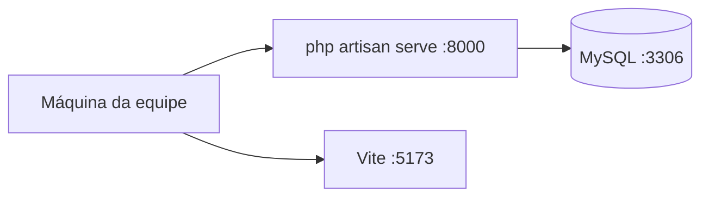

# Arquitetura do Sistema

Documento central do projeto. Descreve como o sistema é organizado e, principalmente, como as camadas se comunicam, do navegador ao banco de dados. Este é o ponto de maior peso na avaliação e deve guiar a apresentação.

## 1. Visão geral

A aplicação segue a arquitetura **MVC em camadas sobre o Laravel**, em modelo **monolítico renderizado no servidor** (server-side rendering com Blade), com **banco relacional MySQL** acessado exclusivamente pelo ORM Eloquent. Há um único processo de aplicação, o que simplifica a implantação local e a demonstração.

## 2. Camadas e responsabilidades

| Camada | Local | Responsabilidade |
|---|---|---|
| Apresentação | `resources/views`, Tailwind, Alpine.js | Renderizar HTML, componentes reutilizáveis, interação no cliente (arrastar e soltar, modais) |
| Roteamento | `routes/web.php` | Mapear URL e verbo HTTP para um controller; aplicar middleware |
| Middleware | `auth`, `verified`, `VerifyCsrfToken` | Autenticação, sessão, proteção CSRF |
| Controle | `app/Http/Controllers` | Receber a requisição, delegar e escolher a resposta. Sem regra de negócio |
| Validação | `app/Http/Requests` | Validar e normalizar a entrada antes de chegar ao controller |
| Autorização | `app/Policies` | Decidir se o usuário pode ver ou alterar um recurso |
| Serviço | `app/Services` | Regras de negócio, transações e registro de atividades |
| Domínio e persistência | `app/Models` (Eloquent) | Entidades, relacionamentos, escopos e mapeamento objeto-relacional |
| Acesso a dados | Eloquent, Query Builder, PDO | Gerar SQL parametrizado e executar no MySQL |
| Banco de dados | MySQL 8 | Armazenamento, integridade referencial, índices e transações |

## 3. Ciclo de uma requisição

Exemplo: o usuário move um cartão de "A fazer" para "Em andamento" no Kanban.

Passos em prosa: o navegador envia a requisição com cookie de sessão e token CSRF; o middleware autentica; o roteador chama o controller; o `FormRequest` valida; a `Policy` autoriza; o `Service` abre uma transação, altera a tarefa e grava o log de atividade; o Eloquent traduz as operações em SQL com parâmetros vinculados via PDO; o MySQL confirma a transação; o controller responde.

## 4. Comunicação entre banco de dados e back-end

Esta seção responde diretamente à pergunta "como o banco de dados se comunica com o back-end".

1. **Configuração.** O arquivo `.env` define `DB_CONNECTION=mysql`, host, porta, nome do banco, usuário e senha. `config/database.php` lê essas variáveis e monta a conexão.
2. **Driver.** O Laravel usa a extensão **PDO (pdo_mysql)** do PHP para abrir a conexão TCP com o MySQL na porta 3306. A conexão é criada de forma preguiçosa, na primeira consulta da requisição, e encerrada ao final.
3. **Abstração.** O código da aplicação nunca escreve SQL manualmente. Os **Models Eloquent** (`Project`, `Task`, `User`, `Comment`, `ActivityLog`) representam tabelas, e métodos como `Task::where(...)->with('assignee')->get()` são convertidos pelo Query Builder em SQL.
4. **Segurança.** Todas as consultas usam **prepared statements** com parâmetros vinculados, o que elimina SQL Injection. Atribuição em massa é limitada por `$fillable`.
5. **Relacionamentos.** `Project hasMany Task`, `Task belongsTo User` (responsável), `Project belongsToMany User` (tabela pivô `project_user` com `role`). Carregamento antecipado com `with()` evita o problema N+1.
6. **Integridade.** O banco impõe chaves estrangeiras, unicidade e `NOT NULL`; a aplicação valida antes (FormRequest), e o banco é a última barreira.
7. **Transações.** Operações compostas (mover tarefa e registrar atividade; criar projeto e vincular proprietário) executam em `DB::transaction`, garantindo atomicidade.
8. **Esquema versionado.** Migrations em `database/migrations` criam e evoluem o esquema; seeders e factories geram dados de demonstração. `php artisan migrate:fresh --seed` reconstrói o banco do zero.
9. **Sessões e cache.** Sessão e cache usam o próprio MySQL (`SESSION_DRIVER=database`), evitando um serviço adicional.

## 5. Autenticação e autorização

- **Autenticação:** Laravel Breeze (formulários Blade). Senhas com hash bcrypt (`Hash::make`); sessão em cookie `HttpOnly` com ID armazenado em `sessions`.
- **Autorização:** `ProjectPolicy` e `TaskPolicy`. Regra base: só membros do projeto veem o projeto e suas tarefas; só o proprietário edita, arquiva ou gerencia membros; membros criam e movem tarefas e comentam.
- **CSRF:** token em todos os formulários e no cabeçalho `X-CSRF-TOKEN` das requisições do Alpine.js.

## 6. Módulos funcionais

| Módulo | Rotas principais | Observação |
|---|---|---|
| Autenticação | `/register`, `/login`, `/logout` | Breeze |
| Painel | `GET /dashboard` | Indicadores calculados por `DashboardService` com agregações SQL |
| Projetos | `resource /projects` | CRUD, arquivamento |
| Membros | `POST/DELETE /projects/{p}/members` | Convite por e-mail de usuário já cadastrado |
| Tarefas | `resource /projects/{p}/tasks`, `PATCH /tasks/{t}/status` | Kanban |
| Comentários | `POST /tasks/{t}/comments` | |
| Atividades | `GET /projects/{p}/activity` | Linha do tempo |

## 7. Front-end

Páginas renderizadas por Blade com layout único (`layouts/app.blade.php`) e componentes (`x-card`, `x-button`, `x-modal`, `x-badge`). **Tailwind CSS** define a identidade visual por tokens; **Alpine.js** trata modais, menus e o arrastar e soltar do Kanban (com SortableJS), enviando `fetch` ao back-end com CSRF. **Vite** compila e serve os assets (hot reload em desenvolvimento).

## 8. Estrutura de diretórios

Ver mapa em `CLAUDE.md`. Fluxo de dependência permitido: `Controller -> Service -> Model`. Camadas inferiores nunca chamam superiores; Blade só lê dados já preparados.

## 9. Implantação e execução

Local: `php artisan serve` + `npm run dev` + MySQL local. Remota (opcional): PHP-FPM + Nginx, `npm run build`, `php artisan migrate --force`, `php artisan config:cache route:cache`. O enunciado aceita execução local ou remota.

## 10. Decisões e trade-offs

| Decisão | Alternativa | Motivo |
|---|---|---|
| Monólito com Blade | SPA React/Vue + API | Menos partes móveis, entrega no prazo, boa estética com Tailwind |
| Eloquent ORM | SQL manual | Segurança, produtividade, relacionamentos expressivos |
| MySQL | SQLite/PostgreSQL | Alinhado à disciplina de banco de dados; relacional e robusto |
| Services | Lógica no controller | Testabilidade e controllers finos |
| Sessão no banco | Redis | Dispensa serviço extra |

Detalhes em `docs/adr/0001-stack.md`.

## 11. Limitações conhecidas e evolução

Sem notificações em tempo real (WebSockets), sem envio de e-mail de convite e sem API pública. Evoluções possíveis: Laravel Reverb para tempo real, filas para e-mails, API REST com Sanctum, anexos em tarefas.
