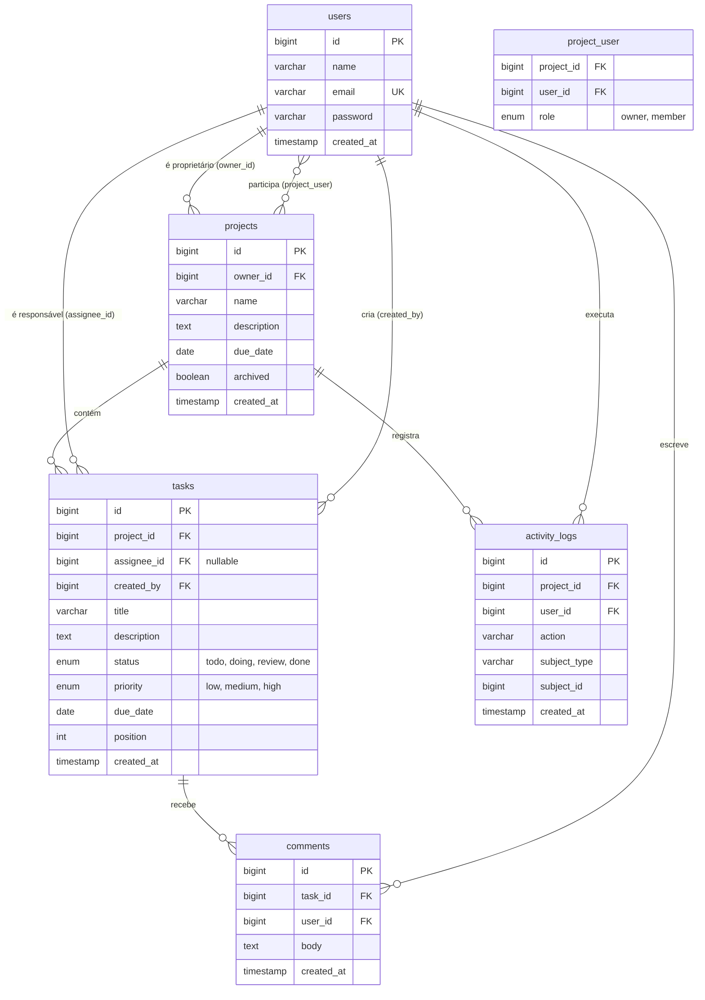

# Modelo de Dados

Banco MySQL 8, charset `utf8mb4`, collation `utf8mb4_unicode_ci`, engine InnoDB (chaves estrangeiras e transações). Esquema criado por migrations.

## Diagrama entidade-relacionamento

## Regras de integridade

| Relação | Ação ao excluir |
|---|---|
| `projects.owner_id -> users.id` | RESTRICT |
| `project_user.project_id -> projects.id` | CASCADE |
| `project_user.user_id -> users.id` | CASCADE |
| `tasks.project_id -> projects.id` | CASCADE |
| `tasks.assignee_id -> users.id` | SET NULL |
| `comments.task_id -> tasks.id` | CASCADE |
| `activity_logs.project_id -> projects.id` | CASCADE |

Restrições adicionais: `users.email` único; `(project_id, user_id)` chave primária composta em `project_user`.

## Índices

`tasks (project_id, status, position)` para montar o Kanban; `tasks (assignee_id)`; `tasks (due_date)` para tarefas atrasadas; `comments (task_id)`; `activity_logs (project_id, created_at)`.

## Mapeamento Eloquent

| Model | Relacionamentos |
|---|---|
| `User` | `ownedProjects` hasMany, `projects` belongsToMany (pivot `role`), `assignedTasks` hasMany |
| `Project` | `owner` belongsTo, `members` belongsToMany, `tasks` hasMany, `activities` hasMany |
| `Task` | `project` belongsTo, `assignee` belongsTo, `creator` belongsTo, `comments` hasMany |
| `Comment` | `task` belongsTo, `author` belongsTo |
| `ActivityLog` | `project` belongsTo, `user` belongsTo |

## Consultas de destaque (para a demonstração)

O painel usa agregações em uma única consulta por indicador: contagem de tarefas por status (`GROUP BY status`), tarefas atrasadas (`due_date < CURDATE() AND status <> 'done'`) e carga por responsável (`JOIN users ... GROUP BY assignee_id`). Executadas via Query Builder em `DashboardService`.

## Dados de demonstração

`DatabaseSeeder` cria 2 usuários, 2 projetos, cerca de 20 tarefas distribuídas entre os status, comentários e atividades, para que o painel e o Kanban já apareçam preenchidos.
