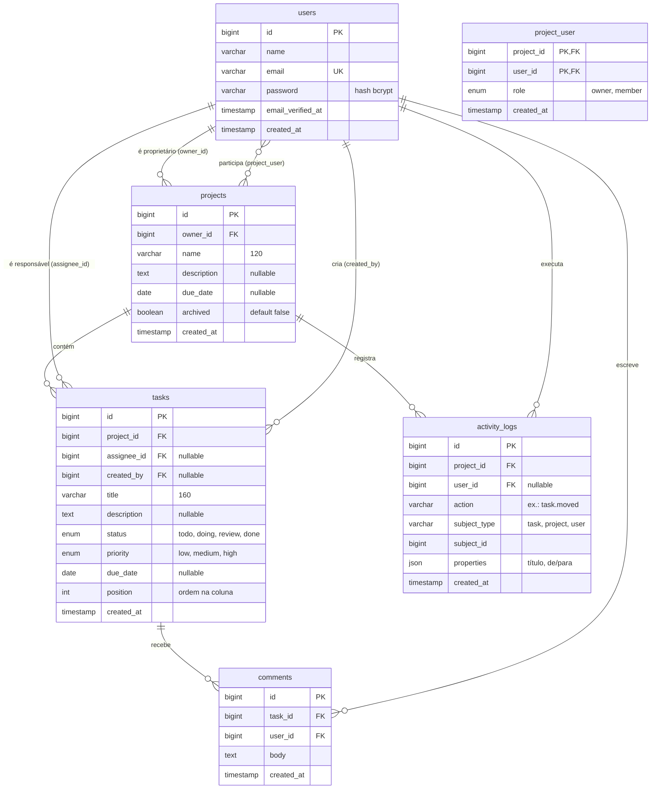

# Modelo de Dados

Banco MySQL 8, charset `utf8mb4`, collation `utf8mb4_unicode_ci`, engine InnoDB (chaves estrangeiras e transações). Esquema criado por migrations em `database/migrations` (arquivos `2026_11_09_00000X_*`). Nos testes automatizados o mesmo esquema roda em SQLite em memória.

## Diagrama entidade-relacionamento



Todas as tabelas de domínio têm `created_at` e `updated_at`, exceto `activity_logs`, que é um registro imutável e só tem `created_at`.

## Regras de integridade

| Relação | Ação ao excluir | Motivo |
|---|---|---|
| `projects.owner_id -> users.id` | RESTRICT | Não se exclui um usuário que ainda é dono de projetos |
| `project_user.project_id -> projects.id` | CASCADE | Excluir o projeto remove os vínculos |
| `project_user.user_id -> users.id` | CASCADE | Excluir o usuário remove suas participações |
| `tasks.project_id -> projects.id` | CASCADE | Tarefas não existem sem projeto |
| `tasks.assignee_id -> users.id` | SET NULL | A tarefa continua, sem responsável |
| `tasks.created_by -> users.id` | SET NULL | Preserva a tarefa se o autor sair |
| `comments.task_id -> tasks.id` | CASCADE | Comentários pertencem à tarefa |
| `comments.user_id -> users.id` | CASCADE | Comentários saem junto com a conta |
| `activity_logs.project_id -> projects.id` | CASCADE | Histórico pertence ao projeto |
| `activity_logs.user_id -> users.id` | SET NULL | O histórico permanece ("usuário removido") |

Restrições adicionais: `users.email` único; `(project_id, user_id)` chave primária composta em `project_user`; `status`, `priority` e `role` são `ENUM`, então o banco recusa valores fora da lista mesmo que a validação falhe. A aplicação também valida antes (FormRequest) e, ao excluir a conta, o `ProfileController` avisa em português se o usuário ainda for dono de projetos, em vez de deixar o RESTRICT gerar erro.

Os valores dos ENUMs vêm dos enums PHP `App\Enums\TaskStatus`, `TaskPriority` e `ProjectRole`, usados tanto na migration quanto nos casts dos models, o que mantém banco e código sincronizados.

## Índices

| Índice | Uso |
|---|---|
| `tasks (project_id, status, position)` | Montar o Kanban: tarefas do projeto por coluna, já ordenadas |
| `tasks (assignee_id)`, `tasks (created_by)` | Criados pelas chaves estrangeiras; carga por responsável |
| `tasks (due_date)` | Tarefas atrasadas e prazos próximos |
| `projects (archived)` | Separar ativos e arquivados |
| `comments (task_id)` | Criado pela chave estrangeira; comentários da tarefa |
| `activity_logs (project_id, created_at)` | Linha do tempo do projeto em ordem cronológica |
| `activity_logs (subject_type, subject_id)` | Localizar o histórico de uma tarefa |

## Mapeamento Eloquent

| Model | Relacionamentos | Outros |
|---|---|---|
| `User` | `ownedProjects` hasMany, `projects` belongsToMany (pivot `role`), `assignedTasks` hasMany, `comments` hasMany | senha com cast `hashed` |
| `Project` | `owner` belongsTo, `members` belongsToMany (pivot `role`), `tasks` hasMany, `activities` hasMany | escopos `visibleTo`, `active`, `withProgress` |
| `Task` | `project` belongsTo, `assignee` belongsTo, `creator` belongsTo, `comments` hasMany | casts para os enums; escopos `overdue` e `filter` |
| `Comment` | `task` belongsTo, `author` belongsTo | |
| `ActivityLog` | `project` belongsTo, `user` belongsTo, `subject` morphTo | `properties` com cast `array` (JSON) |

O `subject_type` grava apelidos curtos (`task`, `project`, `user`, `comment`) graças ao `Relation::enforceMorphMap` em `AppServiceProvider`, em vez do nome completo da classe PHP.

Atribuição em massa é limitada pelo atributo `#[Fillable]` de cada model. Campos sensíveis como `owner_id`, `project_id` e `created_by` não são preenchíveis em massa: os Services os definem explicitamente.

## Consultas de destaque (para a demonstração)

O painel (`DashboardService`) calcula cada indicador com **uma consulta agregada** executada pelo MySQL, considerando apenas os projetos ativos dos quais o usuário é membro. SQL real gerado pelo Query Builder (os `?` são parâmetros vinculados via PDO):

```sql
-- Projetos visíveis (escopo Project::visibleTo + active)
SELECT id FROM projects
WHERE EXISTS (SELECT * FROM users INNER JOIN project_user ON users.id = project_user.user_id
              WHERE projects.id = project_user.project_id AND users.id = ?)
  AND archived = ?;

-- Tarefas por status
SELECT status, COUNT(*) AS total FROM tasks
WHERE project_id IN (?, ?) GROUP BY status;

-- Tarefas atrasadas (escopo Task::overdue)
SELECT COUNT(*) AS aggregate FROM tasks
WHERE project_id IN (?, ?) AND due_date < ? AND status != ?;

-- Carga por responsável
SELECT users.id, users.name,
       SUM(CASE WHEN tasks.status <> ? THEN 1 ELSE 0 END) AS open_tasks,
       SUM(CASE WHEN tasks.status =  ? THEN 1 ELSE 0 END) AS done_tasks
FROM tasks INNER JOIN users ON users.id = tasks.assignee_id
WHERE tasks.project_id IN (?, ?)
GROUP BY users.id, users.name ORDER BY open_tasks DESC;

-- Progresso por projeto (withCount gera subconsultas correlacionadas)
SELECT projects.*,
  (SELECT COUNT(*) FROM tasks WHERE projects.id = tasks.project_id) AS tasks_count,
  (SELECT COUNT(*) FROM tasks WHERE projects.id = tasks.project_id AND status = ?) AS done_tasks_count
FROM projects WHERE id IN (?, ?) ORDER BY updated_at DESC LIMIT 5;
```

Observações para a apresentação:

- A data de "hoje" das tarefas atrasadas é enviada pela aplicação como parâmetro (`due_date < ?`), e não com `CURDATE()`, para respeitar o fuso configurado no Laravel (`America/Sao_Paulo`) e funcionar igual no SQLite dos testes. A coluna é comparada diretamente, sem `DATE(due_date)`, para que o índice `tasks(due_date)` possa ser usado.
- Atividade recente e "minhas tarefas" usam `with()`, que gera uma consulta extra `WHERE id IN (...)` por relacionamento, em vez de uma consulta por item (sem N+1). O painel inteiro executa cerca de 10 consultas, independentemente do número de tarefas.
- O teste `DashboardTest` confere que esses números são iguais à contagem real no banco (critério de aceite do RF06).

## Dados de demonstração

`DatabaseSeeder` chama `DemoSeeder` apenas quando a tabela `users` está vazia (assim o seed automático de cada deploy no Railway não duplica dados). O `DemoSeeder` cria:

- **6 usuários**, todos com senha `password`: `admin@demo.test` (Ana Ribeiro), `membro@demo.test` (Bruno Costa), além de Carla, Rafael, Beatriz e Lucas (`<nome>@demo.test`).
- **4 projetos**: "Lançamento do App Mobile" (principal da demonstração, 14 tarefas), "Redesign do Site Institucional" (8), "Campanha de Marketing Q4" (5, **sem** a Ana como membro, para demonstrar o 403) e "Migração de Servidores" (arquivado, 3).
- **30 tarefas** distribuídas entre os quatro status, com prazos relativos à data atual (sempre há tarefas atrasadas e prazos próximos), **8 comentários** e cerca de **100 registros de atividade** coerentes com o status de cada tarefa.

Com isso o painel e o Kanban já aparecem preenchidos logo após `php artisan migrate:fresh --seed`.
